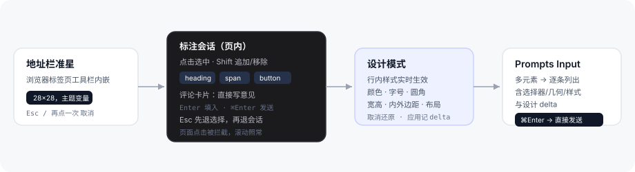
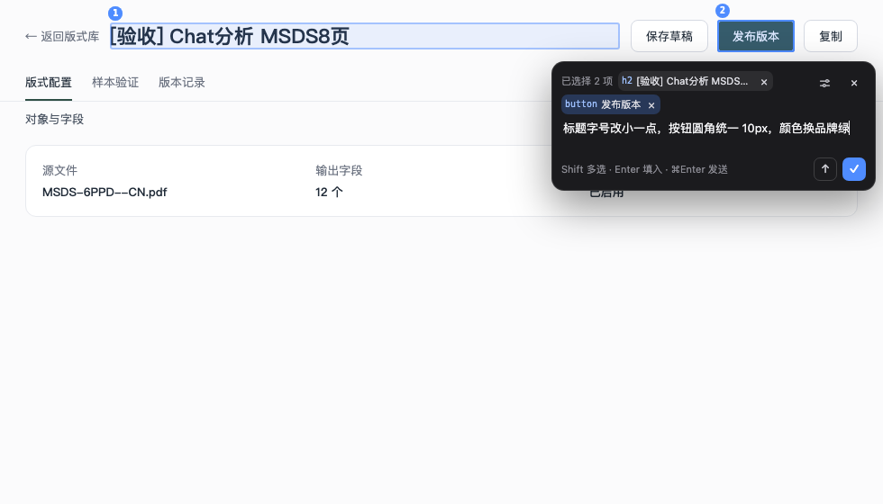
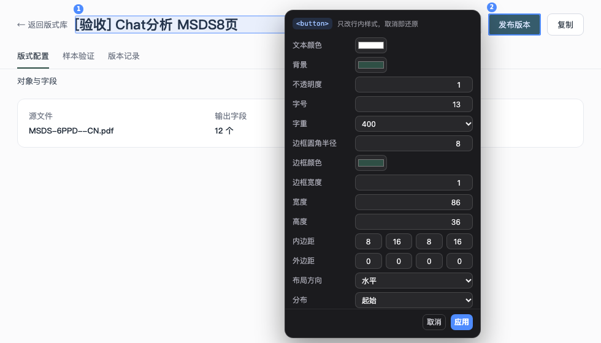

# dsh-plugin-browser-element-picker

在 DeepSeek Harness Desktop 的**侧边浏览器**里做 Codex 式页面标注：点选元素 → 卡片里写意见 →（可选）进设计模式微调样式 → Enter 把整段标注作为**引用块**填进 Prompts Input，⌘/Ctrl+Enter 直接发送。



| 评论卡片（Shift 多选 2 个元素） | 设计模式（16 项属性，实时生效） |
| --- | --- |
|  |  |

## 交互

准星按钮内嵌在标签页**地址栏那一行**（排在「在系统浏览器打开」之后），尺寸/圆角/悬停底色与前后工具按钮一致。

| 操作 | 结果 |
| --- | --- |
| 点准星 | 进入标注会话，页面出现准星光标与顶部提示条 |
| 点击元素 | 选中它，浮出评论卡片（标签 + 文本预览 + 输入框） |
| **Shift + 点击** | 追加/移除一个元素，卡片上的 chips 同步增减（多处一起标注） |
| 点已选中的元素（不按 Shift） | 重新选择，换成当前这一个 |
| 输入评论 | 直接写，支持中文 IME；`Shift+Enter` 换行 |
| **Enter** | 结束会话，把标注作为**引用块**填入输入框（不发送），光标落在块后，直接接着写要求 |
| **⌘/Ctrl+Enter** | 同上，并**立即发送** |
| 卡片上的滑块按钮 | 进入**设计模式**：对该元素做像素级样式调整 |
| 设计模式里 `Enter` | 应用改动，回到卡片 |
| `Esc` | 设计模式 → 放弃改动回到卡片；卡片打开 → 取消选择；都没有 → 退出会话 |

## 设计模式

针对当前选中（chip 高亮）的那个元素，直接改它的**行内样式**并实时生效，同时把改动记进提示词：

- 文本颜色 / 背景 / 不透明度
- 字号 / 字重
- 边框圆角 / 边框颜色 / 边框宽度
- 宽度 / 高度
- 内边距（上右下左）/ 外边距（上右下左）
- 布局方向 / 分布 / 对齐 / 间距

「取消」逐个还原进入设计模式前的行内样式；「应用」保留样式并把 delta 写进标注。设计模式只动行内样式，不生成 CSS 文件——它是"把想法量出来"，不是"替你做实现"。

## 注入的提示词

单个元素：

```
【页面标注】
- 页面：订单列表（http://localhost:5173/orders）
- 选择器：#app > div.list > button.btn.primary:nth-of-type(2)（页面内匹配 1 个元素）
- 元素：<button> 提交订单
- 位置：左 512、上 340，尺寸 120×36；页面视口 1440×900，滚动 (0, 0)
- 计算样式：display: inline-flex; background-color: rgb(64, 86, 255); font-size: 14px; …
- 外部 HTML：<button class="btn primary" data-testid="submit">提交订单</button>
- 设计调整：width: 466px; border-radius: 12px
- 我的意见：背景换成品牌绿

请按上面的意见精确修改这个元素；落到源码时保持相同的选择器语义，并说明改了哪些文件。

修改要求：
```

多处标注（Shift 多选）：

```
【页面标注】共 3 个元素
- 页面：版本发布（http://127.0.0.1:5174/layouts/47ca…?tab=config）
1. <h2> [验收] Chat分析 MSDS8页 — #app > main > h1.title
2. <span> 修订 2 · 草稿 — #app > main > header > span:nth-of-type(2)
3. <button> 保存草稿 — #app > main > header > div.actions > button:nth-of-type(1)
- 设计调整（第 3 个元素）：border-radius: 12px; background-color: #2f4f45
- 我的意见：这三个的间距和圆角统一一下，按钮用品牌绿

请按上面的意见精确修改这些元素；落到源码时保持相同的选择器语义，并说明改了哪些文件。
```

填入走 composer 原生的 `QuoteNode`（shell 的 `insertQuote`）：标注是输入框里一个可 `×` 移除的引用块，不是一个巨大的纯文本段落；连续标注会逐个追加成多个块，光标始终在最后一个块之后。若引用块不可用（例如输入框正忙或该会话的 composer 不接受），自动退化成纯文本追加，并在末尾补一行「修改要求：」。

## 安装

标准 DSH bundle 包（`dsh.bundle.patch` + `dsh.client`），安装后由 `dsh-client-modules` 挂载浏览器端代码，无需重新构建 DSH。

1. 侧边栏 **Plugins** → **Add plugin** → 箭头 → **Install a third-party plugin**
2. 粘贴本目录的绝对路径（先把仓库 clone 到本地，再粘贴该目录）：
   ```
   /path/to/dsh-plugin-browser-element-picker
   ```
3. 勾选信任提示 → **Install**（bundle 默认启用；profile 开了 HMR 会直接热加载）
4. 打开右侧 **Browser** 载入任意 http(s) 页面，地址栏右侧出现准星按钮

改完代码若界面没变化：切走再切回标签页 → 插件页 Off/On → 最后手段重启 App。

## 使用边界

- **仅桌面端生效**。Web 形态的侧边浏览器用 `sandbox` iframe 承载跨域页面，宿主注入不进去；本插件只对 `webview` 生效。
- 只覆盖顶层文档：Iframe 内部、Shadow DOM 内部的元素拾到的会是宿主节点。
- 标注会话期间页面的点击会被拦截（滚动、悬停不受影响），这样点到链接不会跳走。
- 设计模式改的是行内样式，刷新页面即消失；提示词记录的是"你调成了什么"，实现仍由模型落到源码。
- 一键发送走 `conversation.input.shellFor(binding).submit('queue')`，与输入框自己按下 Enter 是同一条提交事务。

## 原理

| 环节 | 实现 |
| --- | --- |
| 按钮挂载 | `MutationObserver` 扫描 `webview[data-sidebar-browser-frame]`，向上找到「直接子节点含地址输入框」的工具栏行把按钮 `append` 进去；React 重渲染丢掉时下一帧 `sync` 补回。探测失败退回悬浮按钮 |
| 标注会话 | 一次 `webview.executeJavaScript(guestAnnotate(...))` 承载整个会话：shadow DOM 里的评论卡片、设计面板、标注框；会话结束（Enter / ⌘Enter / Esc）才把结果 promise 交回宿主 |
| 元素描述 | 选择器优先 `#id`，否则自底向上拼 `tag.class:nth-of-type(n)` 并用 `querySelectorAll` 验证唯一；同时采集文本、属性、视口/文档坐标、计算样式、outerHTML |
| 设计模式 | 读 `getComputedStyle` 作为初值，改动写成 `style.setProperty(prop, value, 'important')`；进入时快照原值，「取消」还原，「应用」把 delta 记进会话结果 |
| 注入提示词 | 从 `webview.closest('[data-sidebar-right-session]')`（回退 `ctx.sidebarRight.mounted`）拿 Session，`conversation.input.shellFor(binding).insertQuote(block)` 插成引用块；失败时退回 `requestDraftInitialization(binding, { prompt, whenDraftExists: 'append' })` |
| 直接发送 | 同一 binding 调 `conversation.input.shellFor(binding).submit('queue')`，与 composer 的 Enter 提交共用事务 |

宿主侧 `lib/index.js` 是空 `apply`：它存在的唯一意义是给 `dsh-client-modules` 一个可以挂载浏览器半边的 Loader 行。

## 卸载

Plugins → 找到本 bundle → **Off** 关掉图层，或 **Remove** 卸载；profile 的 `cordis.patch.yml` 与依赖由插件管理器一并恢复。

## 文件结构

```
sidebar-browser-element-picker/
├── package.json          # dsh.bundle.patch + dsh.client 声明
├── cordis.patch.yml      # 一个 Host 行：browser-element-picker
├── lib/
│   ├── index.js          # Host 半边：空 apply
│   └── client.js         # 浏览器半边：工具栏按钮 + 标注会话 + 提示词
├── docs/flow.svg
└── test/                 # 四层离线测试
```

`lib/client.js` 是手写的 DSH 客户端 bundle（`window.__ModuleLoader__.load({ id, factory })`），刻意不引入 React 与任何依赖，因此也不需要仓库的 tsdown 构建链。

## 自检

需要 Node ≥ 22；最后一个用本机 Playwright 缓存里的 Chromium headless shell。

```bash
cd dsh-plugins/sidebar-browser-element-picker
node test/bundle-contract.test.mjs   # 模块注册契约、i18n 键位、提示词占位符
node test/toolbar.test.mjs           # 工具栏内嵌、重渲染自愈、引用块与直接发送两条链路
node test/injection.test.mjs         # 悬浮兜底路径、单/多元素块、取消不写入、文本兜底
node test/guest-annotate.test.mjs    # 真实 Chromium：多选、卡片输入、设计模式、两种提交、Esc 回退
node test/payload.test.mjs           # 端到端：真实描述符 → 真实格式化器，字段缺失/undefined 会当场失败
```

`guest-annotate.test.mjs` 默认使用
`~/Library/Caches/ms-playwright/chromium_headless_shell-1248/chrome-headless-shell-mac-arm64/chrome-headless-shell`，
可用 `PICKER_CHROME=/path/to/chromium` 覆盖。
